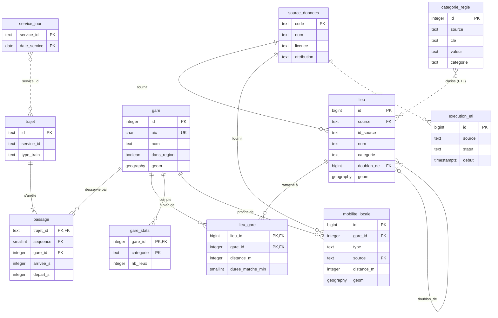

# 03 — Base de données

> **Version** 1.5 · **Date** 11/10/2026
> **Dépend de :** `02-sources-donnees.md`, `GLOSSAIRE.md`
> **Utilisé par :** `04-traitement-donnees.md`, `05-api.md`, `07-contrat-infra.md`, fiches E01 → E09
> **Document de référence pour :** tables, colonnes, contraintes, index, rôles, migrations.

---

## 1. Principes

1. **PostgreSQL 16 + PostGIS 3.4**, extensions `postgis` et `pg_trgm` (similarité de noms).
2. **Toute géométrie est en `geography(…, 4326)`** : les distances sont directement en mètres. *Avec `geometry`, les distances seraient en degrés et chaque requête devrait convertir.*
3. **Le schéma est déclaré dans Drizzle** (`apps/web/src/lib/db/schema.ts`). drizzle-kit génère les migrations SQL dans `db/migrations/`. Ce que Drizzle ne sait pas générer va dans une **migration SQL personnalisée** (`pnpm db:generer --custom --name=<nom>`) : extensions (`0000_extensions`, `IF NOT EXISTS` car l'image PostGIS crée déjà `postgis` dans la base principale) et droits (`0002_droits`). Les index GIST et GIN trigramme et les CHECK sont générés par Drizzle ; les listes des CHECK viennent de `@tourisme/commun` (`CATEGORIES`, `TYPES_TRAIN`, `TYPES_MOBILITE`, `STATUTS_EXECUTION`). **Toujours générer avec `pnpm db:generer`**, jamais `drizzle-kit generate` seul (voir point 4).
4. **Le type `geography` est déclaré par un `customType` Drizzle** (`lib/db/types-postgis.ts`), une seule fois : `geographyPoint`, lu en `{ lon, lat }`. drizzle-kit 0.31 écrit ce type entre guillemets (`"geography(Point, 4326)"`), ce que PostgreSQL refuse : `pnpm db:generer` les retire après chaque génération et échoue s'il en reste (D033).
5. **Aucune donnée utilisateur** en v1. La position n'est jamais stockée.
6. **Les heures de train sont des entiers** (secondes depuis minuit, peuvent dépasser 86 400). **Les jours sont des `date`.** Aucun `timestamp` pour les horaires.
7. **Tout nom de table et de colonne en français, `snake_case`, sans accents** (voir `GLOSSAIRE.md`).
8. **Chargement sans interruption :** l'ETL remplace les lignes d'une source **dans une transaction** (suppression + insertion). Pendant ce temps, l'application continue de lire l'ancienne version. *PostgreSQL garantit qu'un lecteur ne voit jamais un état à moitié chargé.*

---

## 2. Vue d'ensemble des tables

```
                 ┌──────────────┐
                 │ source_donnees│◀── execution_etl
                 └──────────────┘
┌────────┐   ┌─────────┐   ┌─────────┐   ┌──────────────┐
│  gare  │◀──│ passage │──▶│ trajet  │──▶│ service_jour │
└───┬────┘   └─────────┘   └─────────┘   └──────────────┘
    │  ▲
    │  └──── liaison_directe (gare_depart_id, gare_arrivee_id, date_service)
    │
    ├──── lieu_gare ──▶ lieu ◀── categorie_regle (utilisée par l'ETL)
    ├──── gare_stats
    └──── mobilite_locale

 ligne_ferroviaire (P1)      amenagement_cyclable (P1)
```

Les 11 tables créées en E01 et leurs liens (trait plein = clé étrangère ; pointillé = lien par valeur, sans clé étrangère) :



| Table | Rôle | Remplie par | Prio |
|---|---|---|---|
| `gare` | Toutes les gares de France (petite table) | ETL `gares` | P0 |
| `trajet` | Trains (trips GTFS) touchant la région | ETL `gtfs_sncf` | P0 |
| `passage` | Arrêts de chaque trajet | ETL `gtfs_sncf` | P0 |
| `service_jour` | Jours de circulation, dépliés par date | ETL `gtfs_sncf` | P0 |
| `liaison_directe` | Paires de gares reliées sans correspondance, par date | ETL (calcul) | P0 |
| `lieu` | Lieux de la région | ETL `datatourisme`, `osm`, `lieux_culturels`, `festivals` | P0 |
| `categorie_regle` | Règles de classement des lieux | Fichier versionné, chargé par l'ETL | P0 |
| `lieu_gare` | Lieux à distance de marche de chaque gare | ETL (calcul) | P0 |
| `gare_stats` | Nombre de lieux par catégorie autour de chaque gare | ETL (calcul) | P0 |
| `mobilite_locale` | Arrêts bus/tram, stations vélos près des gares | ETL `transport_local` | P0 |
| `source_donnees` | Métadonnées et licences des sources | ETL | P0 |
| `execution_etl` | Journal des exécutions de l'ETL | ETL | P0 |
| `ligne_ferroviaire` | Tracés des lignes | ETL `lignes` | P1 |
| `amenagement_cyclable` | Pistes et voies vertes | ETL `cyclable` | P1 |

*Pourquoi toutes les gares de France et pas seulement la région :* un train régional peut aller jusqu'à Lyon ou Paris. Pour afficher ces destinations, leurs gares doivent exister. Seuls les **lieux** sont limités à la région.

---

## 3. Détail des tables

Conventions : `NN` = non nul · `PK` = clé primaire · `FK` = clé étrangère · `UQ` = unique.

### 3.1 `gare`
| Colonne | Type | Contraintes | Description |
|---|---|---|---|
| `id` | integer | PK, identity | |
| `uic` | char(8) | NN, UQ | Code UIC |
| `nom` | text | NN | Nom affiché |
| `commune` | text | | |
| `code_insee` | char(5) | | Commune |
| `departement` | char(3) | | Dérivé du code INSEE |
| `dans_region` | boolean | NN, défaut false | Gare de la région pilote |
| `geom` | geography(Point, 4326) | NN | |
| `maj` | timestamptz | NN, défaut now() | Dernier chargement |

Index : GIST(`geom`), (`dans_region`).

### 3.2 `trajet`
| Colonne | Type | Contraintes | Description |
|---|---|---|---|
| `id` | text | PK | `trip_id` GTFS |
| `service_id` | text | NN | |
| `type_train` | text | NN, CHECK in (`TER`,`INTERCITES`,`TGV`,`AUTRE`) | |
| `nom_ligne` | text | | Nom court de la ligne |
| `numero` | text | | Numéro du train si disponible |

Index : (`service_id`).

### 3.3 `passage`
| Colonne | Type | Contraintes | Description |
|---|---|---|---|
| `trajet_id` | text | PK (1/2), FK → trajet ON DELETE CASCADE | |
| `sequence` | smallint | PK (2/2) | Ordre de l'arrêt |
| `gare_id` | integer | NN, FK → gare | |
| `arrivee_s` | integer | | Secondes depuis minuit (peut dépasser 86 400) |
| `depart_s` | integer | | idem |

Index : (`gare_id`), (`trajet_id`, `sequence`) via la clé.

### 3.4 `service_jour`
| Colonne | Type | Contraintes | Description |
|---|---|---|---|
| `service_id` | text | PK (1/2) | |
| `date_service` | date | PK (2/2) | Jour où le service circule |

Index : (`date_service`).
Dépliage de `calendar.txt` + exceptions de `calendar_dates.txt`, limité à la fenêtre `parametres.fenetreJoursHoraires`.

### 3.5 `liaison_directe`
| Colonne | Type | Contraintes | Description |
|---|---|---|---|
| `gare_depart_id` | integer | PK (1/3), FK → gare | |
| `gare_arrivee_id` | integer | PK (2/3), FK → gare | |
| `date_service` | date | PK (3/3) | |
| `duree_min` | smallint | NN | Durée du train le plus rapide |
| `nb_trains` | smallint | NN | Trains directs ce jour-là |
| `premier_depart_s` | integer | NN | |
| `dernier_depart_s` | integer | NN | |
| `types_train` | text[] | NN | Types présents (TER, TGV…) |
| `distance_km` | numeric(6,1) | NN | Estimation (voir `04` § Distance) |

Index : (`gare_depart_id`, `date_service`).
Calculée uniquement pour les gares de départ **dans la région** et sur la fenêtre `parametres.fenetreJoursLiaisons`.

### 3.6 `lieu`
| Colonne | Type | Contraintes | Description |
|---|---|---|---|
| `id` | bigint | PK, identity | |
| `source` | text | NN, FK → source_donnees(code) | |
| `id_source` | text | NN | Identifiant dans la source |
| `nom` | text | NN | |
| `categorie` | text | NN, CHECK in (`enfants`,`nature`,`parcs`,`patrimoine`,`culture`) | |
| `sous_categorie` | text | | Libellé lisible (« aire de jeux »…) |
| `description` | text | | Courte, nettoyée |
| `adresse` | text | | |
| `commune` | text | | |
| `code_insee` | char(5) | | |
| `url` | text | | Site officiel |
| `image_url` | text | | |
| `horaires` | text | | Texte tel que fourni |
| `periode` | text | | Festivals : période de l'année |
| `qualite_tourisme` | boolean | NN, défaut false | |
| `doublon_de` | bigint | FK → lieu(id) | Rempli si fusionné dans un autre lieu |
| `geom` | geography(Point, 4326) | NN | |
| `maj` | timestamptz | NN, défaut now() | |

Contraintes : UQ(`source`, `id_source`).
Index : GIST(`geom`), (`categorie`), GIN(`nom` gin_trgm_ops).
Les requêtes de l'application ignorent les lignes où `doublon_de` n'est pas nul.

### 3.7 `categorie_regle`
| Colonne | Type | Contraintes | Description |
|---|---|---|---|
| `id` | integer | PK, identity | |
| `source` | text | NN | `datatourisme`, `osm`, `lieux_culturels`, `festivals` |
| `cle` | text | NN | Ex. `leisure`, ou `categorie` pour DATAtourisme |
| `valeur` | text | NN | Ex. `playground`, ou l'URI/libellé DATAtourisme |
| `categorie` | text | | Catégorie cible ; **nul = à exclure** |
| `sous_categorie` | text | | Libellé affiché |
| `priorite` | smallint | NN, défaut 100 | Plus petit = prioritaire si plusieurs règles s'appliquent |

Contrainte : UQ(`source`, `cle`, `valeur`).
Source de vérité : `etl/src/regles/categories.csv` (versionné, éditable sans code), chargé à chaque exécution.

### 3.8 `lieu_gare`
| Colonne | Type | Contraintes | Description |
|---|---|---|---|
| `lieu_id` | bigint | PK (1/2), FK → lieu ON DELETE CASCADE | |
| `gare_id` | integer | PK (2/2), FK → gare | |
| `distance_m` | integer | NN | Distance à pied estimée |
| `duree_marche_min` | smallint | NN | |

Index : (`gare_id`, `distance_m`).

### 3.9 `gare_stats`
| Colonne | Type | Contraintes | Description |
|---|---|---|---|
| `gare_id` | integer | PK (1/2), FK → gare | |
| `categorie` | text | PK (2/2) | |
| `nb_lieux` | integer | NN | Lieux de cette catégorie dans le rayon de la gare |

### 3.10 `mobilite_locale`
| Colonne | Type | Contraintes | Description |
|---|---|---|---|
| `id` | bigint | PK, identity | |
| `gare_id` | integer | NN, FK → gare | Gare la plus proche |
| `type` | text | NN, CHECK in (`BUS`,`TRAM`,`VELO`,`TROTTINETTE`,`AUTRE`) | |
| `nom` | text | NN | Nom de l'arrêt ou de la station |
| `lignes` | text[] | | Numéros de lignes (bus/tram) |
| `operateur` | text | | Réseau ou opérateur |
| `source` | text | NN, FK → source_donnees(code) | |
| `id_source` | text | | Identifiant dans la source (ex. `station_id` GBFS, pour lire la disponibilité des vélos en direct) |
| `distance_m` | integer | NN | Distance à pied depuis la gare |
| `geom` | geography(Point, 4326) | NN | |

Index : (`gare_id`, `distance_m`).

### 3.11 `source_donnees`
| Colonne | Type | Contraintes | Description |
|---|---|---|---|
| `code` | text | PK | Voir codes dans `02` |
| `nom` | text | NN | |
| `producteur` | text | NN | |
| `url` | text | NN | Page de la source |
| `licence` | text | NN | |
| `attribution` | text | NN | Texte à afficher |
| `date_telechargement` | timestamptz | | |
| `empreinte` | text | | SHA-256 du fichier téléchargé |
| `nb_lignes` | integer | | Lignes chargées |

### 3.12 `execution_etl`
| Colonne | Type | Contraintes | Description |
|---|---|---|---|
| `id` | bigint | PK, identity | |
| `source` | text | NN | |
| `debut` | timestamptz | NN | |
| `fin` | timestamptz | | |
| `statut` | text | NN, CHECK in (`EN_COURS`,`SUCCES`,`ECHEC`,`IGNORE`) | `IGNORE` = fichier inchangé |
| `nb_lignes` | integer | | |
| `message` | text | | Résumé ou erreur |

### 3.13 `ligne_ferroviaire` (P1)
| Colonne | Type | Contraintes |
|---|---|---|
| `id` | integer | PK, identity |
| `code_ligne` | text | |
| `nom` | text | |
| `geom` | geography(MultiLineString, 4326) | NN |

Index : GIST(`geom`).

### 3.14 `amenagement_cyclable` (P1)
| Colonne | Type | Contraintes |
|---|---|---|
| `id` | bigint | PK, identity |
| `id_source` | text | NN, UQ |
| `type` | text | NN (`VOIE_VERTE`, `PISTE`, `BANDE`, `AUTRE`) |
| `nom` | text | |
| `geom` | geography(LineString, 4326) | NN |

Index : GIST(`geom`).

---

## 4. Rôles et droits

| Rôle | Utilisé par | Droits |
|---|---|---|
| `proprietaire` | Migrations uniquement | Propriétaire du schéma |
| `etl_ecriture` | ETL | SELECT, INSERT, UPDATE, DELETE sur toutes les tables ; CREATE TEMP |
| `app_lecture` | Application web | **SELECT uniquement** |

*Pourquoi :* l'application ne peut rien modifier, même en cas de faille.

**Création :** les rôles `etl_ecriture` et `app_lecture` sont créés **avec leur mot de passe par un script** (`MDP_APP_LECTURE`, `MDP_ETL_ECRITURE`, voir `07-contrat-infra.md`), lancé par `pnpm db:migrer` avant les migrations. Les migrations ne contiennent que les droits (`GRANT`, `ALTER DEFAULT PRIVILEGES`), jamais de mot de passe. *Pourquoi :* une migration SQL ne lit pas les variables d'environnement, et un mot de passe écrit dans une migration serait versionné (D031).

---

## 5. Requêtes de référence

```sql
-- Gares les plus proches d'une position
SELECT id, nom, ST_Distance(geom, ST_MakePoint(:lon, :lat)::geography) AS distance_m
FROM gare
ORDER BY geom <-> ST_MakePoint(:lon, :lat)::geography
LIMIT :limite;

-- Lieux autour d'une position
SELECT id, nom, categorie, ST_Distance(geom, :point) AS distance_m
FROM lieu
WHERE doublon_de IS NULL
  AND categorie = ANY(:categories)
  AND ST_DWithin(geom, :point, :rayon_m)
ORDER BY distance_m
LIMIT :limite;

-- Destinations depuis une gare à une date
SELECT l.gare_arrivee_id, g.nom, l.duree_min, l.nb_trains, l.premier_depart_s, l.dernier_depart_s
FROM liaison_directe l
JOIN gare g ON g.id = l.gare_arrivee_id
WHERE l.gare_depart_id = :gare AND l.date_service = :date AND l.duree_min <= :duree_max
ORDER BY l.duree_min;

-- Trains directs A → B à une date, à partir d'une heure
SELECT a.trajet_id, a.depart_s, b.arrivee_s, t.type_train, t.numero
FROM passage a
JOIN passage b ON b.trajet_id = a.trajet_id AND b.sequence > a.sequence
JOIN trajet t ON t.id = a.trajet_id
JOIN service_jour s ON s.service_id = t.service_id AND s.date_service = :date
WHERE a.gare_id = :depart AND b.gare_id = :arrivee AND a.depart_s >= :depuis_s
ORDER BY a.depart_s;
```

---

## 6. Données d'exemple

`db/echantillon/echantillon.sql` contient un **petit jeu cohérent** (10 gares aux codes UIC fictifs `EX…`, 5 trajets sur une date d'été et une date d'hiver, 30 lieux dont un doublon, 3 transports sur place), rattaché à la source `echantillon`. Il est chargé uniquement dans la base de test `<base>_test` par `pnpm db:test:preparer` (lancé par `pnpm test:integration`). **Jamais** mélangé aux vraies données.

---

## 7. Plus tard (non créé en v1)

| Évolution | Tables |
|---|---|
| Connexion Google (Auth.js) | `utilisateur`, `compte`, `session`, `jeton_verification` (schéma Auth.js) |
| Favoris synchronisés | `favori` (utilisateur_id, gare_id ou lieu_id) |
| Pépite méconnue | colonne `frequentation` sur une table `commune` |

---

## Historique

| Date | Version | Modification |
|---|---|---|
| 30/09/2026 | 1.0 | Création |
| 30/09/2026 | 1.1 | `mobilite_locale.id_source` (vélos disponibles, D019) |
| 05/10/2026 | 1.2 | Chemin des règles de catégories : `etl/src/regles/categories.csv` (D024) |
| 09/10/2026 | 1.3 | § 4 : rôles et mots de passe créés par script, droits seuls dans les migrations — D031 |
| 11/10/2026 | 1.4 | E01 : migrations personnalisées (extensions, droits), correction du type `geography` par `pnpm db:generer`, échantillon et base de test — D033 |
| 11/10/2026 | 1.5 | § 2 : diagramme Mermaid des 11 tables créées en E01 et de leurs liens |
